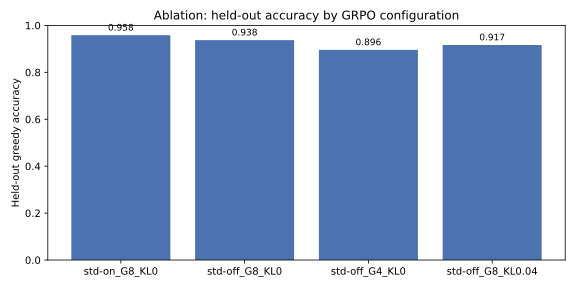

# RLVR Agent — Verifiable-Reward GRPO for Tool-Using Reasoning Agents

GRPO implemented from scratch in NumPy, with a tool-using agent and a
verifiable reward, so the whole reinforcement-learning loop can be read,
tested, and run on a CPU in minutes — and the same design maps directly
onto the production stack (TRL / vLLM, SageMaker Training Sessions).

The core question this repository answers is practical, not theoretical:
**when the reward is a deterministic checker instead of a learned reward
model, which GRPO details actually matter?** The code isolates the
details the October 2026 literature is debating — group-standard-deviation
normalisation, group size, and the KL term — and measures them on the
same data, with the same evaluation, instead of asserting an answer.

## What it is

One coherent system covering data engineering, reinforcement learning,
generative-AI agents, and evaluation:

```
tasks (deterministic generator)
  -> validation / dedup / stratified split / SQLite store + hash manifest
  -> policy (NumPy MLP over 6 solution strategies)
  -> agent loop (calculator + retrieval tools, tool-call budget, trace)
  -> verifier (exact answer, format, tool efficiency) -> reward
  -> GRPO update (group-relative advantage, clipped surrogate, KL)
  -> held-out evaluation (accuracy, pass@k, Brier score, hacking checks)
```

* **Data engineering** — `rlvr/data.py`: deterministic arithmetic word
  problems, schema validation, deduplication by `(a, b, op, template)`,
  stratified split with no key leakage between train/validation/test,
  SQLite storage (standard library), and a SHA-256 dataset manifest.
  External JSONL records are re-validated and rejected, never silently
  corrected, when their stated answer disagrees with a recomputation.
* **RL** — `rlvr/grpo.py` and `rlvr/policy.py`: GRPO from scratch.
  Group-relative advantages with a flag for std normalisation on/off,
  clipped PPO-style surrogate (with optional DAPO clip-higher), KL
  penalty against a frozen reference policy, entropy and KL logging.
  No critic, no torch, no GPU required.
* **Gen AI agent** — `rlvr/agent.py` and `rlvr/tools.py`: a tool-using
  loop over six strategies (direct, calculator, decompose, verify,
  retrieve, estimate). The calculator is a strict integer parser, not
  `eval`. The retrieval tool is a local knowledge base standing in for
  a real retriever, keeping the system offline and reproducible.
* **Evaluation** — `rlvr/evaluate.py` and `rlvr/ablation.py`: held-out
  greedy accuracy, pass@k, Brier score for the policy's confidence,
  and reward-hacking diagnostics (formatted-but-wrong, excess tool
  calls). The ablation runner trains each configuration from the same
  seed on the same split and evaluates on the same test set.

## Measured results

All numbers below were produced by running the code in this repository
on 27 October 2026 (Python 3.12, NumPy, CPU). The raw outputs are in
`results/measured.json` and `results/ablation.json`; the plot is in
`results/ablation.svg`. Counts are shown alongside rates because the
test set is small — a difference of one task is 0.021 in accuracy.

Dataset: 300 tasks, split 209 train / 43 validation / 48 test, stratified
by operator. Operators: `+` 76, `-` 75, `*` 70, `/` 79. Difficulty
(by answer magnitude): easy 123, medium 157, hard 20.

### Training (80 steps, group size 8, no-std, KL coefficient 0)

| Model | Held-out accuracy | Brier score | pass@8 |
|---|---|---|---|
| Untrained policy (seed 42 init) | 0.854 (41/48) | 0.406 | 1.000 |
| Uniform-random strategy choice | 0.854 (41/48) | — | — |
| Trained policy | **0.958 (46/48)** | **0.348** | 1.000 |

Training reward rose from 0.822 at step 1 to 0.924 at step 80, and
policy entropy fell from 1.573 to 1.399. The baseline is high because
the environment's success probabilities are generous; the headroom was
7 tasks, and training closed 5 of them. `pass@8` is 1.000 for every
configuration measured here, so it does not discriminate between them
and is reported for completeness, not as evidence of a difference.
The hacking-flag rate for the trained policy was 0.128 (49 of 384
sampled traces flagged, mostly formatted-but-wrong traces, which are
expected whenever accuracy is below 1.0).

### Ablation (40 steps each, same seed, same split, same test set)

| Configuration | Accuracy | Brier | Mean confidence | Final train reward |
|---|---|---|---|---|
| std-on, G=8, KL 0 | 0.958 (46/48) | 0.062 | 0.848 | 0.977 |
| std-off, G=8, KL 0 | 0.938 (45/48) | 0.408 | 0.354 | 0.936 |
| std-off, G=4, KL 0 | 0.896 (43/48) | 0.409 | 0.344 | 0.910 |
| std-off, G=8, KL 0.04 | 0.917 (44/48) | 0.408 | 0.349 | 0.921 |

Read this table carefully. The accuracy differences are 1–3 tasks on
48, which is not enough to declare a winner. The Brier difference is
larger, but it runs in the opposite direction from the AlphaBet
forecasting result (see Research below): in *this* setup the std-on
policy became much more confident (0.848 vs 0.354) and its confidence
happened to be well calibrated. That does not refute AlphaBet. The
reward here is binary correctness plus a small format bonus, not a
proper score over reported probabilities, and the policy chooses
between strategies rather than reporting a probability distribution
over outcomes. The correct conclusion is narrower and more useful:
**measure calibration for your own reward and policy, do not import
the direction of an ablation from a different task.** The no-std
variant remains the safer default when the reward is a proper score
over probabilities, for the reasons AlphaBet and Dr. GRPO give.



## How to run

```bash
pip install -r requirements.txt
python -m unittest discover -s tests -v
PYTHONPATH=src python scripts/train.py --steps 80
PYTHONPATH=src python scripts/evaluate.py
PYTHONPATH=src python scripts/run_ablation.py --steps 40
```

`config/default.yaml` holds the default training configuration.
Training takes seconds on a CPU. The checkpoint is written to
`results/policy.npz` (excluded from version control by `.gitignore`);
the metrics files in `results/` are the measured outputs described
above and are committed so the README figures can be checked.

To use your own tasks, supply a JSONL file with `question`, `answer`,
`a`, `b`, and `op` fields to `build_dataset(..., extra_jsonl=...)`.
Records that fail validation raise an error instead of being fixed
silently.

## Scaling to a real LLM

The NumPy policy is a stand-in for a language model so the GRPO
machinery can be tested exactly. The production mapping is in
`src/rlvr/scaleup/`:

* **TRL / vLLM** (`trl_grpo.py`): the same reward contract — a
  callable returning one float per completion — with
  `GRPOTrainer`, `num_generations` as the group size,
  `scale_rewards=False` for the no-std variant, `beta=0.0` for the
  KL term off, and `loss_type="dapo"` for DAPO-style aggregation.
  Generation dominates wall-clock time at this scale, so rollouts
  go through vLLM (`use_vllm=True`, colocate or server mode).
* **SageMaker Training Sessions** (`sagemaker_loop.py`): a sketch
  of the same loop on the training-session APIs that became
  generally available on 22 October 2026 — the developer writes
  `sample()` / reward / `forward_backward()` / `optim_step()` in
  Python while SageMaker AI manages GPUs, distribution, fault
  recovery, and checkpoints, billed per token with the meter
  stopped while reward code runs. This sketch requires the
  SageMaker SDK, an IAM role, and an S3 output location; it is not
  executed here.
* **Harness** (`rlvr/agent.py`): recent work on coding agents
  (HarnessAdapt-RL, Self-HPO, October 2026) finds that the harness
  and the policy must be developed together — a policy trained
  under one harness does not automatically transfer to another.
  Keep the tool budget, trace format, and verifier fixed when
  comparing policies, and version the harness alongside the model.

Before running the scale-up code, pin the `trl` / `transformers` /
`vllm` versions and re-check the `GRPOConfig` field names against
the installed release; this area changed quickly during 2026.

## Research

Research was done before coding, on 27 October 2026, from primary
sources where available. Full notes, including what was *not* taken
at face value, are in `docs/RESEARCH.md`.

1. Ye et al., **AlphaBet: Reinforcement Learning for LLM Event
   Forecasting Agents**, arXiv:2610.22684, submitted 15 Oct 2026.
   GRPO std normalisation can distort the reporting target under
   multi-class proper scores; the no-std variant is used. Brier
   score 0.731 → 0.626 (Forecast-Dojo) and 0.612 → 0.528 (FutureX)
   on GLM-4.5-Air.
   https://arxiv.org/abs/2610.22684v1
2. Liu et al., **Understanding R1-Zero-Like Training: A Critical
   Perspective** (Dr. GRPO), arXiv:2503.20783. Removing the
   std term and the per-response length term removes a difficulty
   bias and a length bias, recovering an unbiased PPO-style
   objective with a Monte-Carlo baseline.
   https://arxiv.org/html/2503.20783
3. Yu et al., **DAPO** (2025), via October 2026 summaries:
   clip-higher (`epsilon_high`, e.g. 0.28), dynamic sampling that
   drops all-equal groups, and token-level loss aggregation.
   https://www.aicassindra.com/blogs/gpu/gpu_grpo.html
4. AWS Machine Learning Blog, **Announcing new ways to customize
   models with SageMaker AI, without managing GPUs**, 22 Oct 2026.
   Training sessions generally available; custom SFT/RL loops,
   per-token billing, meter stopped during reward scoring, support
   for `gpt-oss-20b`, `Qwen3.6-27B`, and `Qwen3.8-27B` at launch.
   https://aws.amazon.com/blogs/machine-learning/announcing-new-ways-to-customize-models-with-sagemaker-ai-without-managing-gpus/
5. TRL `GRPOTrainer` usage current in October 2026:
   `num_generations`, `scale_rewards`, `beta`, `loss_type`,
   `vllm_mode`. Verified against October 2026 write-ups, not from
   memory; field names should be re-checked against the installed
   TRL release before use.
   https://ilirivezaj.com/blog/grpo-rlvr-post-training
6. HarnessAdapt-RL (Tao, Guo, Bao; posted 21 Oct 2026) and
   Self-HPO (Microsoft Research; October 2026): co-training the
   policy with its harness / tool set, rather than freezing the
   harness. HarnessAdapt-RL reports +9.8 / +12.6 / +6.4 points
   pass@1 over a GRPO baseline on SWE-bench variants with a 9B
   model; removing evolved tools at deployment costs up to 7.7
   points.
   https://aiweekly.co/alerts/harnessadapt-rl-lifts-9b-agent-126-pts-on-swe-bench-multilingual
   https://explainx.ai/blog/self-hpo-harness-policy-optimization-coding-agents-microsoft-research-2026

## Limitations

* The environment is synthetic and the policy is tiny. Results
  demonstrate the GRPO machinery and the measurement discipline,
  not LLM-scale performance.
* The test set has 48 tasks. Ablation differences of a few tasks
  are suggestive, not conclusive; rerun with more tasks and
  multiple seeds before drawing a strong conclusion.
* Execution noise (15% slip for good strategies, 5% luck for poor
  ones) is an explicit, seeded modelling choice, documented in
  `rlvr/agent.py`. Real LLM rollouts are noisier and the noise is
  not independent of the prompt.
* The Brier score here measures confidence in the chosen strategy,
  adapted from AlphaBet's forecasting use. It is not directly
  comparable to AlphaBet's reported Brier scores.

## Interview talking points

* "I removed the learned critic and replaced it with a group
  baseline, then tested whether dividing by the group standard
  deviation helps or hurts for *my* reward — and found the answer
  depends on whether the reward is a proper score."
* "The verifier is code, not a model, so the reward cannot drift.
  The format bonus is capped below the correctness reward, so
  formatting alone can never win."
* "I version the harness with the policy: tool budget, trace
  format, and verifier are part of the experiment, because recent
  work shows a policy does not transfer across harnesses for free."
* "Every number in the README is recomputed from the committed
  results files, with counts shown, because a 48-task test set
  makes a 0.02 accuracy gap meaningless on its own."

## Layout

```
src/rlvr/          data, rewards, tools, agent, policy, grpo, train, evaluate, ablation
src/rlvr/scaleup/  TRL and SageMaker mappings (reference only, not run in CI)
scripts/           train / evaluate / run_ablation entry points
tests/             unittest suite (18 tests)
config/            default training configuration
results/           measured outputs committed for checking
docs/              research notes
```

## License

MIT — see `LICENSE`.
